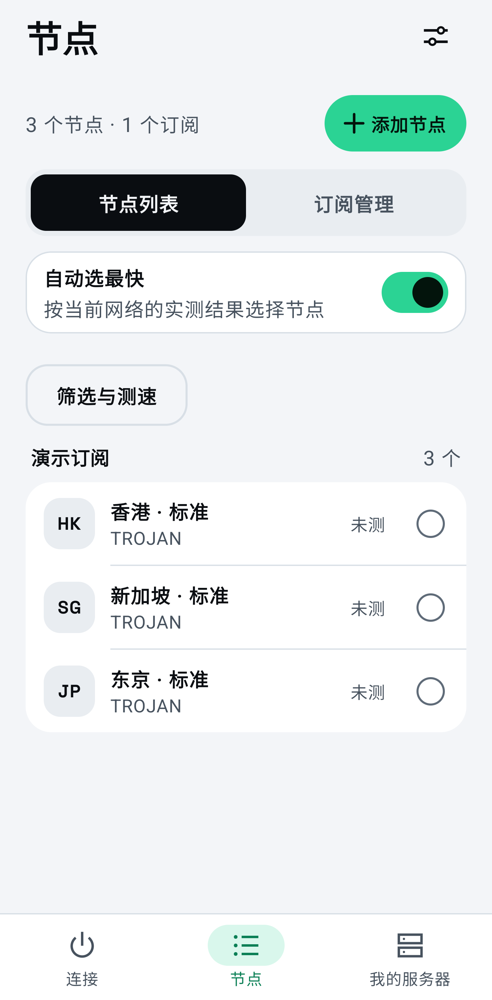
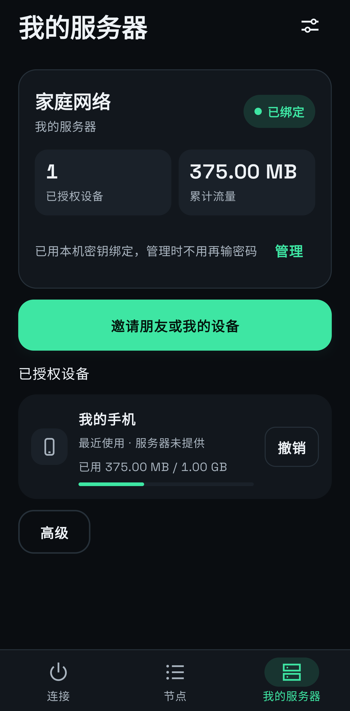

# Nexus

Nexus 是无需注册的 Android 代理客户端，支持机场订阅、自建私人服务器、按应用代理和国内直连。

<p>    </p>
<p>    </p>

## 下载与安装

1. 在 [GitHub Releases](https://github.com/shejiang000-prog/Nexus/releases/latest) 下载 APK 和同一版本的 `SHA256SUMS.txt`。多数手机选 `arm64`，x86_64 模拟器或不确定架构时选 `universal`。
2. 校验下载文件。Windows 使用 `Get-FileHash .\Nexus-1.0.0-arm64.apk -Algorithm SHA256`；Linux 使用 `sha256sum Nexus-1.0.0-arm64.apk`。核对校验文件中同名 APK 的整串摘要。
3. 在手机打开 APK，为当前浏览器或文件管理器允许「安装未知应用」，安装后可以关闭这项授权。后续从相同发布渠道覆盖更新。

## 首次使用

1. 选择「添加机场订阅」粘贴链接或扫码，或在「我的服务器」绑定自己的服务器。
2. 在「节点」选择线路，或启用「自动选最快」。收到私人邀请可以点开邀请并选择「接受并连接」。
3. 回到连接页点圆环，确认 Android 的 VPN 授权。连接页可以切换「绕过大陆」或「全局代理」。

## 常见问题

**手机清理后台后断线怎么办？** 在设置的「断线自动恢复」中打开系统 VPN 设置，按需启用「始终开启的 VPN」。如需重启手机后恢复上一次仍在使用的连接，另行打开「开机后自动连接」。 部分系统会拦截开机广播。若首次解锁后仍未连接，可打开 Nexus 手动连接；S24 Ultra 本轮实测遇到了这一限制。

**国内访问 GitHub 慢怎么办？** 已有可用节点时先连接，再检查更新或打开 Release 页面。也可以在另一台能访问 GitHub 的设备下载 APK 和校验文件，校验后传入手机安装。

**从开发版切换怎么办？** 公开版包名为 `dev.nexus.android`，可以与开发版并存。两者使用独立的本地存储和密钥。请在公开版重新添加订阅或领取设备邀请。

## 许可证与隐私

Nexus 以 GPL-3.0 发布。随包分发的第三方代码、规则和字体保留各自许可证。[GPL-3.0 全文](LICENSE) · [第三方声明](THIRD_PARTY_LICENSES.md) · [隐私说明](PRIVACY.md)

## 工程资料

- [Android 构建、导入和使用](docs/ANDROID.md)
- [工程架构](ARCHITECTURE.md) · [协议规范](PROTOCOL_SPEC.md) · [威胁模型](SECURITY.md)
- [验收矩阵](TEST_PLAN.md) · [依赖](DEPENDENCIES.md) · [交接与实测记录](docs/handoff/INDEX.md)

## 核心复验

```sh
cargo build --workspace --locked
cargo test --workspace --locked
python3 tools/test_tunnel.py
```

需要 OpenSSL 3 和 Python 3。Windows 可将 OPENSSL 设置为 Git 附带的 openssl.exe 完整路径。测试使用临时身份及临时端口，按字节核对独立 HTTP/UDP 目标。可选的 tools/test_windows_linux.py --public 在指定 WSL2 实例内运行普通权限服务并额外请求 example.com。

## 手工启动 CLI

先用 `python3 tools/lab_identity.py lab-identity` 在私有目录生成短期开发身份，cd 到该目录。假定目标为测试机上的 127.0.0.1:8000，分别运行：

```sh
../target/debug/nexus-server 127.0.0.1:4443 ca.der server.der server.key.der device.der 127.0.0.1:8000
../target/debug/nexus-client auto 127.0.0.1:4443 nexus.test ca.der device.der device.key.der tcp 127.0.0.1:8000 127.0.0.1:18080
```

向 127.0.0.1:18080 发出的字节将发送给授权目标。支持 auto/quic/tls 和 tcp/udp。仅在自己的受控环境使用文件私钥。Windows 外壳可通过 `cargo build --manifest-path apps/desktop/Cargo.toml --locked` 构建。
