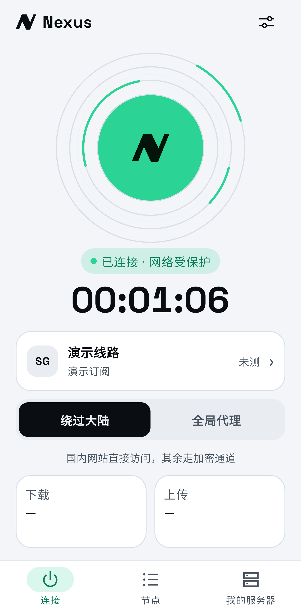
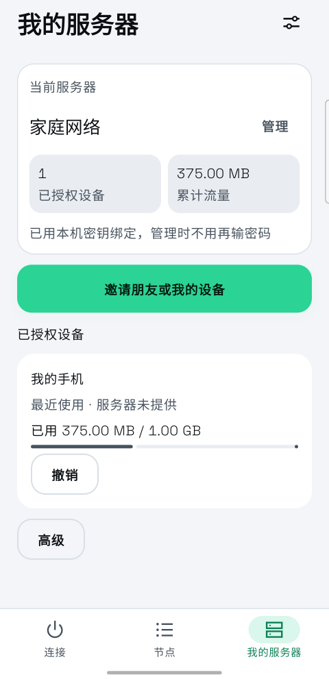
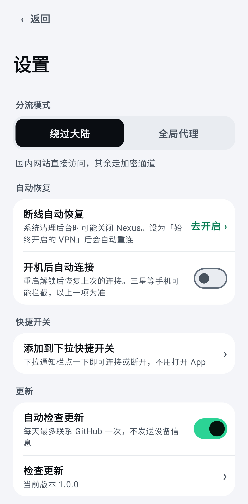
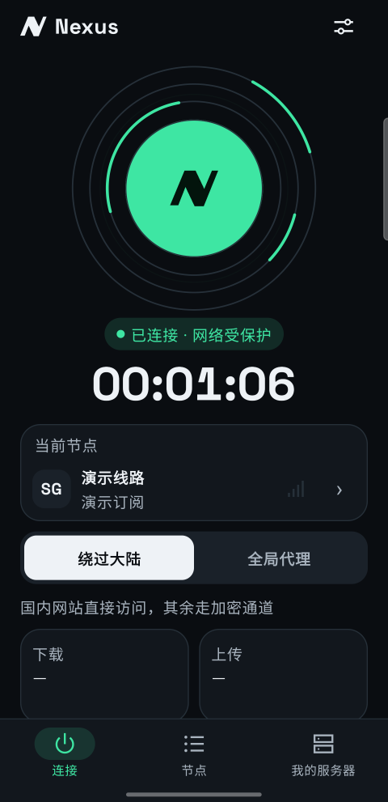
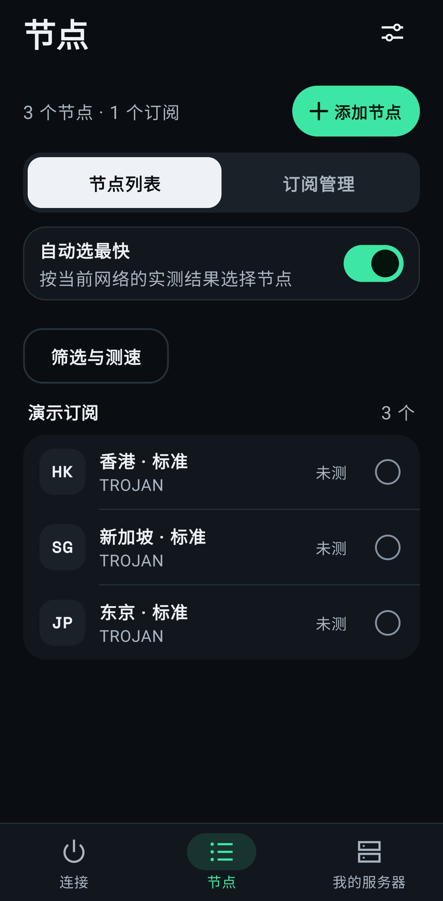
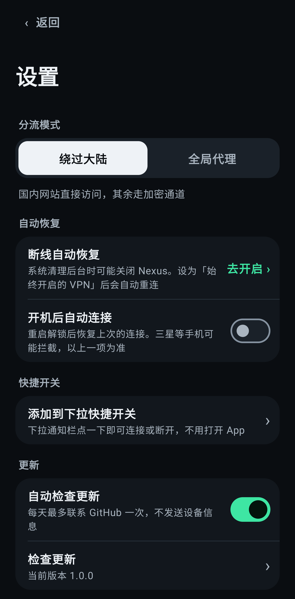

# Nexus

Nexus 是无需注册的 Android 代理客户端。你可以使用已有的第三方订阅，也可以一键部署自己的 V2 私人节点，通过邀请分享给亲友。两种方式都支持按应用代理和绕过大陆。

    

    

## 下载与安装

1. 在 [GitHub Releases](https://github.com/shejiang000-prog/Nexus/releases/latest) 下载 APK 和同一版本的 `SHA256SUMS.txt`。多数手机选 `arm64`，x86_64 模拟器或不确定架构时选 `universal`。
2. 以 2.0.0 的 arm64 包为例，在 Windows 运行 `Get-FileHash .\Nexus-2.0.0-arm64.apk -Algorithm SHA256`，在 Linux 运行 `sha256sum Nexus-2.0.0-arm64.apk`。核对同名 APK 的完整摘要。使用 Android SDK 的 `apksigner verify --print-certs Nexus-2.0.0-arm64.apk` 可进一步核对正式签名证书，SHA-256 应为 `D6:9F:CF:1C:0B:B7:60:DF:D7:EA:DD:21:D8:61:2C:30:B0:56:46:FD:0B:1D:A0:56:95:50:24:59:A4:02:83:B3`。
3. 在手机打开 APK，为当前浏览器或文件管理器允许「安装未知应用」，安装后可以关闭这项授权。后续从相同发布渠道覆盖更新。

## 首次使用

1. 有订阅时，选择「添加机场订阅」并粘贴链接或扫码。收到私人节点邀请时，粘贴或扫描 V2 邀请，核对节点后确认领取。
2. 自建节点时，打开「我的服务器」填写 SSH 连接信息。域名留空会部署 V2 和 Reality。有域名时可以使用自动续期的公有证书，并启用 Hysteria2。
3. 在「节点」选好线路，回到连接页点圆环，确认 Android 的 VPN 授权。V2 会在 UDP 受阻时切到 H2，恢复后有业务时会尝试回到 H3。

管理员可按天数或永久分享 V2 使用权，并在设备行续期或撤销。V2 邀请供本应用一次领取，Reality 和 Hysteria2 可单独导出兼容链接。需要协助排查连接时，在设置点击「导出诊断信息」，由你选择分享给谁。

正式版 1.0.1 可覆盖升级到正式版 2.0.0。升级会清除本机的 V1 私人节点、邀请与绑定信息，保留第三方订阅。使用私人节点时需部署或绑定 V2 节点，成员重新领取 V2 邀请。

## 常见问题

**节点没有 IPv6 出口，会影响哪些应用？** Nexus 会把能识别出域名的流量按域名交给节点，大多数应用不受影响。少数游戏或 P2P 下载工具会直接连接 IPv6 地址，流量里也没有域名，这时可能连不上。遇到这种情况，换一个支持 IPv6 的节点即可。

**手机清理后台后断线怎么办？** 在设置的「断线自动恢复」中打开系统 VPN 设置，按需启用「始终开启的 VPN」。如需重启手机后恢复上一次仍在使用的连接，另行打开「开机后自动连接」。 部分系统会拦截开机广播。若首次解锁后仍未连接，可打开 Nexus 手动连接；S24 Ultra 本轮实测遇到了这一限制。

**国内访问 GitHub 慢怎么办？** 已有可用节点时先连接，再检查更新或打开 Release 页面。也可以在另一台能访问 GitHub 的设备下载 APK 和校验文件，校验后传入手机安装。

**从开发版切换怎么办？** 公开版包名为 `dev.nexus.android`，可以与开发版并存。两者使用独立的本地存储和密钥。请在公开版重新添加订阅或领取设备邀请。

## 许可证与隐私

Nexus 以 GPL-3.0 发布。随包分发的第三方代码、规则和字体保留各自许可证。[GPL-3.0 全文](LICENSE) · [第三方声明](THIRD_PARTY_LICENSES.md) · [隐私说明](PRIVACY.md)

## 工程资料

- [Android 构建、导入和使用](docs/ANDROID.md)
- [V2 客户端传输接口](docs/protocol/v2-transport-api.md) · [节点账本](docs/protocol/v2-node-ledger.md)
- [依赖](DEPENDENCIES.md) · [公网与真机实测记录](docs/handoff/2026-11-25-m4-2-public.md)
